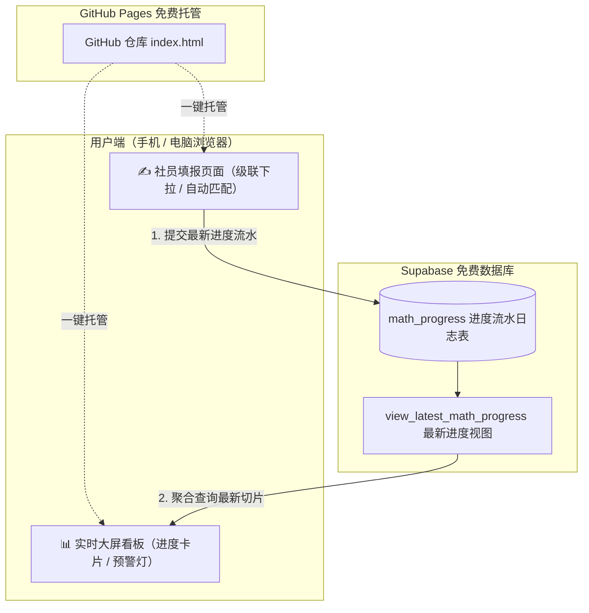

# 📐 数学社 · 全校高数与数分教学进度实时追踪系统
*(Math Progress Tracker for University Math Club)*

一套专为高校数学社团打造的**零服务器成本、免运维、全自动自适应**的高等数学与数学分析教学进度分布式追踪看板。

通过社团内部成员网格化对接各学院专业，实时汇报一线授课进度，以最新上报为准自动聚合，为全校同学提供进度横向对比，并为社团期中/期末集中答疑提供精准靶向数据支持。

---

## 🌟 核心特性

- **📱 移动端友好 & 零编译单文件**：采用 Vue 3 + Tailwind CSS 纯静态单页面架构，无需 Node.js/npm 打包编译，双击即用，完美适配手机浏览器填报。
- **🤖 智能课程体系自适应**：
  - **理学院数学专业**（统计学、数学与应用数学）自动切换为 **《数学分析》体系**（分第(1)(2)(3)学期）；
  - **轮机工程学院** 智能区分：海上专业自动匹配 **高数B**，陆上专业自动匹配 **高数A**；
  - **航海学院** 兼容 **高数A / 高数B** 自由选择；
  - **外国语学院 & 法学院** 自动锁定单学期制 **高数D**（无上下册分期）；
  - **公共管理与人文艺术学院** 自动匹配 **高数C**；
  - 其他理工科专业统一匹配 **高数A**。
- **📚 正版教材目录小节级严格对标**：
  - **高等数学**：逐字对齐高等教育出版社出版的 **最新同济大学《高等数学》（第八版/第七版）** 上下册共 12 章 80 节；
  - **数学分析**：逐字对齐高等教育出版社出版的 **华东师范大学《数学分析》（第五版）** 上下册三学期全章节；
  - 课程切换时章节下拉列表全自动联动更新，社员无需手动打字，避免格式错乱。
- **📊 实时大屏与时效性警示**：
  - 数据以「学院 + 专业 + 课程」为维度，自动提取**最新一次上报记录**；
  - **时效指示灯**：🟢 3天内更新（活跃）、🟡 一周内（正常）、🔴 超过7天未更新（延期预警），方便社长群内针对性催更；
  - 支持按高数A/B/C/D、数分一键切片筛选，支持专业/章节/上报人多维度关键字搜索。
- **🔒 企业级数据安全**：基于 Supabase PostgreSQL 行级安全策略（Row Level Security），前端匿名用户仅允许读取看板和插入最新日志，防篡改与恶意删除。

---

## 🏗️ 架构设计与技术栈



- **前端框架**：Vue 3 (Composition API CDN)
- **UI 样式**：Tailwind CSS (CDN)
- **数据层 SDK**：`@supabase/supabase-js v2`
- **后端服务**：Supabase (Serverless PostgreSQL + 自动化 RESTful API)
- **托管平台**：GitHub Pages（亦可无缝部署至 Cloudflare Pages 或 Vercel）

---

## 🚀 极速部署指南

### 第一步：创建 Supabase 数据库表与视图
1. 注册并登录 [Supabase](https://supabase.com)，新建一个 Project；
2. 进入左侧导航栏的 **SQL Editor**，新建查询并执行以下 SQL：

```sql
-- 1. 创建进度流水表
create table math_progress (
  id bigint generated by default as identity primary key,
  college text not null,                -- 学院
  major text not null,                  -- 专业
  course_type text not null,            -- 课程类型 (如 高等数学 A(1), 数学分析(1))
  chapter text not null,                -- 章节
  section text not null,                -- 具体小节
  reporter text not null,               -- 填报社员
  homework text,                        -- 作业/备忘 (选填)
  created_at timestamp with time zone default timezone('utc'::text, now()) not null
);

-- 2. 开启行级安全策略 (RLS)
alter table math_progress enable row level security;

-- 允许匿名提交 (insert)
create policy "Allow anon insert" on math_progress
  for insert with check (true);

-- 允许匿名读取 (select)
create policy "Allow anon select" on math_progress
  for select using (true);

-- 3. 创建核心视图：实时提取每个专业最新的一条记录
create or replace view view_latest_math_progress as
select distinct on (college, major, course_type)
  id,
  college,
  major,
  course_type,
  chapter,
  section,
  reporter,
  homework,
  created_at
from math_progress
order by college, major, course_type, created_at desc;
```

3. 点击顶部导航栏的 **`Connect`** 按钮（或进入 Project Settings ➔ Data API），复制得到你的 `SUPABASE_URL` 和 `SUPABASE_PUBLISHABLE_KEY`。

---

### 第二步：配置前端文件
打开项目根目录下的 `index.html`，找到以下配置项，替换为你自己的 Supabase 参数：

```javascript
const SUPABASE_URL = "https://你的项目ID.supabase.co";
const SUPABASE_ANON_KEY = "你的_publishable_key";
const supabaseClient = window.supabase.createClient(SUPABASE_URL, SUPABASE_ANON_KEY);
```

---

### 第三步：发布到 GitHub Pages
1. 在 GitHub 上新建公开仓库（如命名为 `math-progress-tracker`）；
2. 将 `index.html` 与 `README.md` 推送或直接上传到仓库根目录；
3. 进入仓库 **Settings** ➔ **Pages**：
   - **Source** 选择：`Deploy from a branch`；
   - **Branch** 选择：`main` / `/ (root)`；
   - 点击 **Save**；
4. 约 1 分钟后，即可获得属于你们数学社的专属公开网址：
   `https://<你的GitHub用户名>.github.io/math-progress-tracker/`。

---

## 👥 数学社线下运营与落地建议

在高校中，“拿不到学委一手数据”是社团常态，建议通过以下机制实现稳定运转：

1. **社员网格化认领制**：
   - 在社团内部制作一张院系专业覆盖清单，每个专业指定 1~2 名本社社员作为**“常驻信息员”**；
   - 规定每周五高数课结束后，信息员用手机顺手花 10 秒钟填报一次。
2. **红灯催更机制**：
   - 社团干事每周定期查看大屏，凡是状态亮红灯（超过 7 天未更新）的专业，直接在社群中 `@` 该专业对应负责的同学核实。
3. **活动靶向赋能（期末串讲/答疑）**：
   - 临近期中或期末考试前，社长直接根据大屏数据掌握全校各专业授课进度与作业分布，提前 1~2 周组织有针对性的“重难点串讲会”和“高数答疑坊”，大幅提升社团在全校的影响力！

---

## 📄 开源许可
本项目遵循 [MIT License](LICENSE) 开源。欢迎各大高校数学社、数模协会 Fork 改造并在各自学校推广使用！
